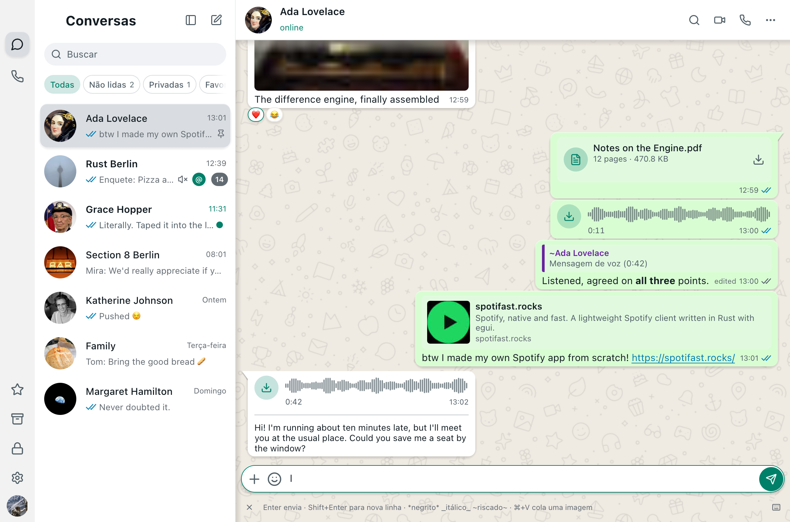

<p align="center">
  
</p>

<h1 align="center">ZapFast w/ Transcribe</h1>

<p align="center">
  <strong>WhatsApp, native and fast, with local voice message transcription powered by Parakeet.</strong><br>
</p>

[ZapFast](https://github.com/crmne/zapfast) is a fast, native WhatsApp client written in Rust and egui.
This fork adds **local voice message transcription**: read a voice note without playing it, 
with no cloud, no Python and no GPU required.

## About this fork

This repository is a fork of [alexandrereyes/zapfast](https://github.com/alexandrereyes/zapfast), 
which is itself a fork of the original [crmne/zapfast](https://github.com/crmne/zapfast).

Its sole purpose is to keep the transcription feature from
[PR #740](https://github.com/crmne/zapfast/pull/740) (closed upstream, not merged)
available while staying up to date with the `main` branch of `crmne/zapfast` .

> **Note:** the prebuilt packages and the documentation site linked from the
> upstream project come from upstream and **do not include transcription**.
> To use it, build this fork (see [Install](#install)).

<picture>

    

</picture>

## Local voice message transcription

* **Runs on your machine.** [NVIDIA Parakeet](https://huggingface.co/nvidia/parakeet-tdt-0.6b-v3)
  runs on the CPU through ONNX Runtime. Audio, chat IDs and transcripts are never uploaded.
* **Automatic or manual.** Automatic transcription is opt-in and handles downloaded voice
  notes as they come into view, one at a time. You can also transcribe a single message
  from its menu (**Transcribe** / **Transcribe again**).
* **Selectable, copyable text** appears right under the audio player.
* **25 languages**, including Portuguese.
* **Works fully local and offline**.
* **Stored securely.** Transcripts live in each account's encrypted archive and are
  removed when a message is deleted or revoked.

### Models

Choose one in **Settings → Chats**:

| Model | Download size | Notes |
|---|---|---|
| Parakeet v3 FP32 | ~2.55 GB | Default |
| Parakeet v3 INT8 | ~670 MB | Smaller download |
| Ultra FP32 | ~2.51 GB | |

Models are downloaded from pinned [Hugging Face](https://huggingface.co) revisions and
verified with SHA-256, with progress, pause and retry. Only public model files are
requested, never your data. One model is shared across accounts and unloaded after a
minute of inactivity. Changing models keeps your existing transcripts.

### Platform support

This fork is developed, tested and used only on **Windows**. The original
[PR #740](https://github.com/crmne/zapfast/pull/740) reports that transcription works on
macOS and builds on Linux, but I have not verified either on this fork. They may work, 
but there are no guarantees. Reports from macOS and Linux users are welcome.

Transcription needs Microsoft's ONNX Runtime library at runtime.

## Everything else in ZapFast

| Feature | What you can do |
|---|---|
| **Messages** | Send formatted text, replies, edits, reactions, forwards, pictures, files, stickers, GIFs, polls, and voice messages. |
| **Media in the chat** | Play voice messages, videos, round video messages, GIFs, and animated stickers in place. |
| **Your history** | Keep chats in an encrypted archive on this computer, fetch older messages from your phone as you scroll, and export saved history as text or a ZIP. |
| **Several numbers** | Link more than one WhatsApp number and switch between them in one window. |
| **Desktop controls** | Keyboard shortcuts, text selection across messages, tray icon and notifications. |
| **Themes** | Light, dark, system appearance, or custom colours. |
| **Privacy** | Hide locked chats behind a code, or the whole window behind an app lock. |

The interface is available in English, Chinese (Simplified and Traditional), French, 
German, Indonesian, Italian, Portuguese (Brazil), Russian, Spanish, and Turkish.

## Install

Build from source:

```sh
git clone https://github.com/<your-user>/zapfast.git
cd zapfast
cargo build --release
```

See [Getting started](https://zapfast.rocks/getting-started/) for system dependencies.

## Contributing

Read [CONTRIBUTING.md](CONTRIBUTING.md) first. To explore the interface without a
WhatsApp account:

```sh
cargo run --features demo -- --demo
```

[AGENTS.md](AGENTS.md) describes the architecture, [DEMO.md](DEMO.md) the demo pages, 
and [PACKAGING.md](PACKAGING.md) releases and packages. For changes unrelated to
transcription, please consider contributing to [upstream](https://github.com/crmne/zapfast) too.

## Acknowledgements

* [crmne/zapfast](https://github.com/crmne/zapfast): the original project
* [alexandrereyes/zapfast](https://github.com/alexandrereyes/zapfast): the transcription work (PR #740) and intermediate fork

## Disclaimer

ZapFast is an unofficial client and is not affiliated with WhatsApp or Meta.
Using an unofficial client may be against WhatsApp's terms of service and could
get an account suspended. Use it at your own risk. WhatsApp is a trademark of
WhatsApp LLC.

Licensed under the [MIT License](LICENSE).
